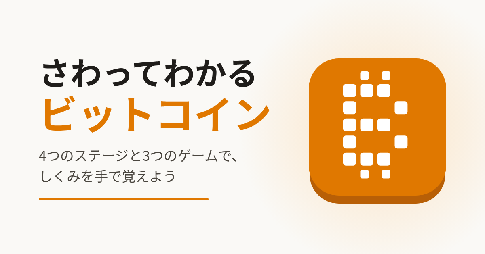

# さわってわかるビットコイン



ビットコインのしくみを、さわって動かしながら学べる初心者向けサイトです。全部ブラウザの中のシミュレーションなので、本物のお金は動きません。

**▶ あそぶ: https://lokuyow.github.io/sawatte-wakaru-bitcoin/**

## まなべること

4つのステージと3つのゲームで、順番に体験できます。各章に1問クイズつき。

- 秘密鍵と署名、鍵の強さ
- みんなで持つ台帳と、コインのかたまり（UTXO）
- ハッシュとブロックチェーン
- マイニングと難易度調整、ブロックが世界に届くまで
- 手数料のオークション
- 報酬半減（ハルビング）と2100万BTCの上限
- ライトニング（ブロックの外で一瞬で払う）
- ゲーム: ニセ取引を見破る / マイニング競争 / 51%攻撃に挑戦

## 特徴

- インストール不要、ブラウザだけですぐ遊べます
- 日本語 / English 切り替え対応
- ダークモード対応
- スマホのホーム画面に追加できます（PWA）

## 開発

ビルドなしの静的サイト（HTML / CSS / JavaScript）です。ローカルで開くなら:

```sh
python3 -m http.server 8765
# http://127.0.0.1:8765/ を開く
```

テストは `tests/` にあります（Playwright を使用。詳しくは `tests/README.md`）。

## ライセンス

[CC0 1.0 Universal](LICENSE) — コード・文章・画像・SVG すべて、表示も許可取りもなしで自由に使えます。
